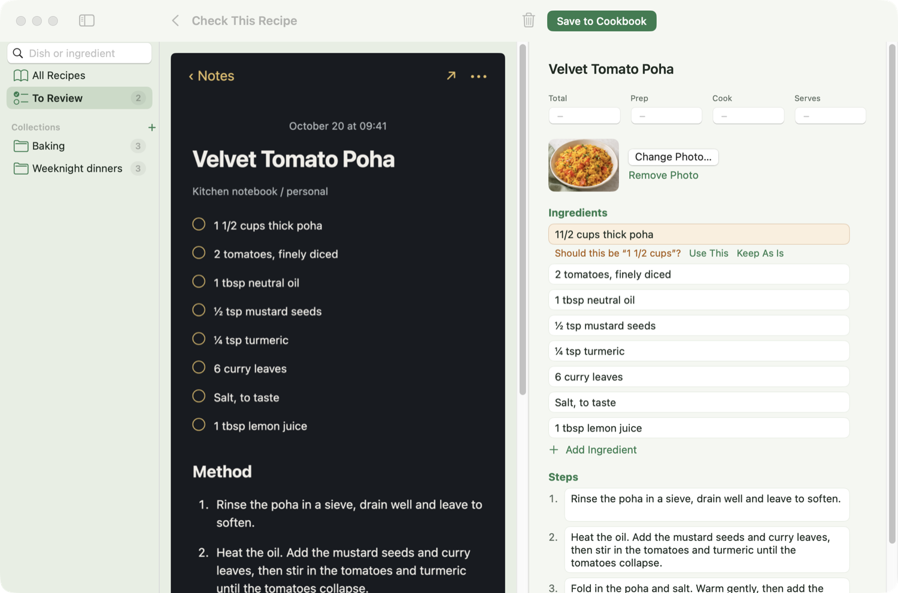
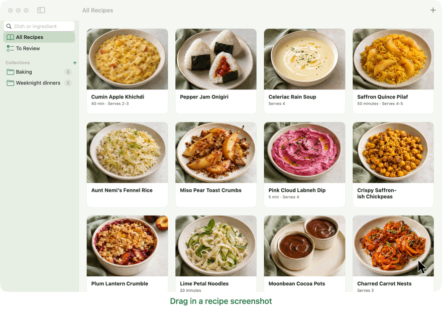
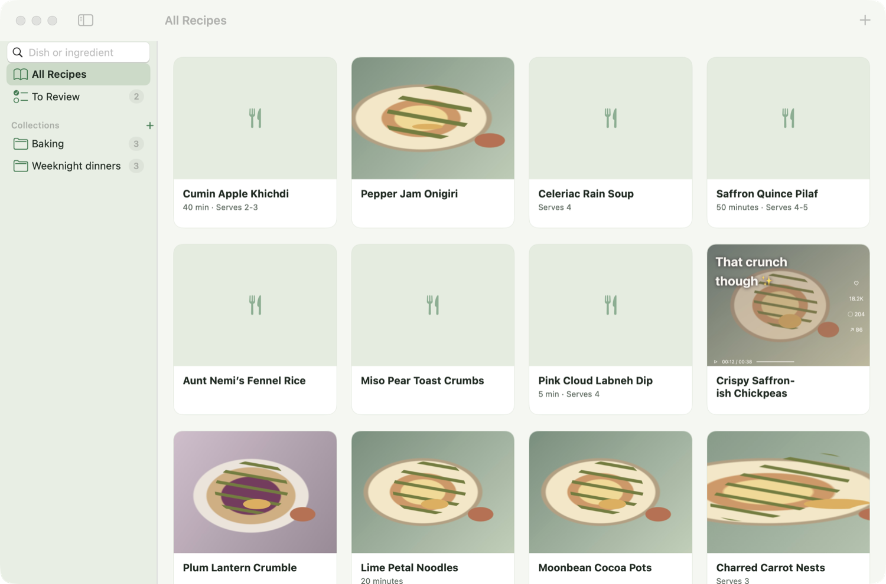
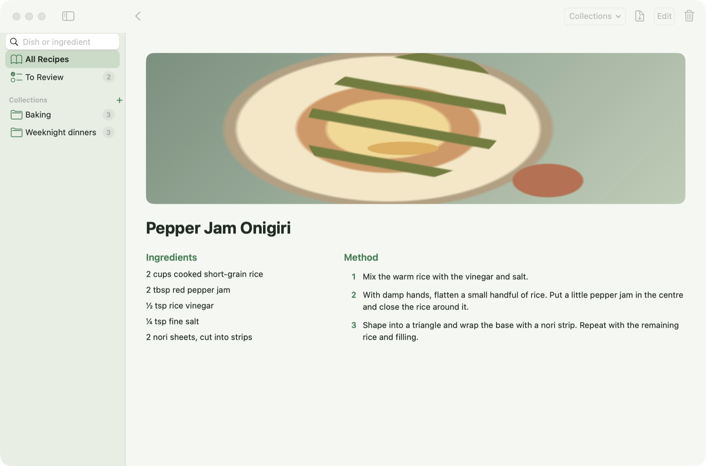
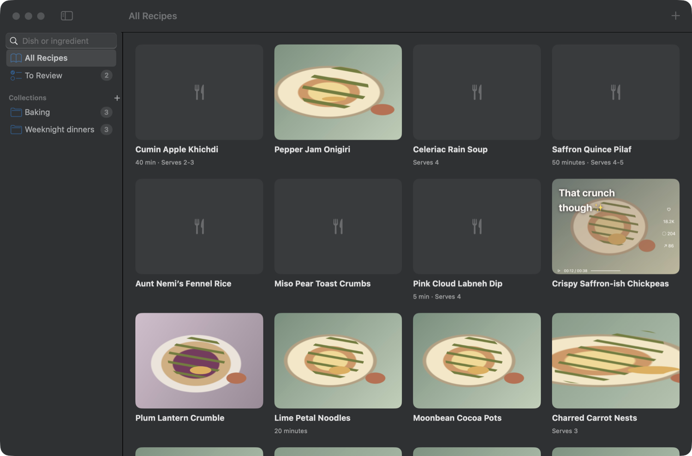
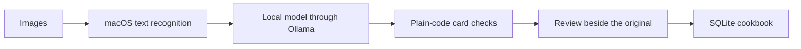

<p align="center">
  
</p>

<h1 align="center">Zendish</h1>

<p align="center"><strong>Turn recipe screenshots into a cookbook you'll actually use.</strong><br>
Drop in a screenshot or photo, check the card beside the original, and save it.<br>
Free, powered by local AI, and everything stays on your Mac.</p>

<p align="center">
  <a href="https://github.com/zenwyn-naicker/zendish/releases/latest/download/Zendish.dmg"><strong>Download for Mac</strong></a>
</p>

<p align="center"><sub>Apple Silicon Mac · macOS 14 or later · 16 GB of memory · No account needed</sub></p>



## How it works

| 1. Add | 2. Check | 3. Cook |
|---|---|---|
| Drag in a screenshot or photo of any recipe. Several images can make up one recipe. | Zendish writes a clean card and shows it beside the original, flagging anything that looks wrong. | Save it to your cookbook, find it again in seconds, and export a PDF for the kitchen. |

## What it does

- **Tidy cards from messy screenshots:** ads, comments and clutter are left out, leaving the title, ingredients, steps, time and servings.
- **Mistakes are easy to catch:** Zendish flags quantities that look misread and ingredients it thinks were missed.
- **No made-up details:** if a time or serving count isn't clearly labelled in the image, it stays blank.
- **A cookbook you'll use:** browse your cards, add a photo, and sort recipes into collections like "Weeknight dinners".
- **Find anything fast:** search by dish or ingredient.
- **Ready for the kitchen:** export one recipe or a whole collection as a PDF.
- **Easy on the eyes:** a calm, fresh design in light or dark.

## See it in action



<p align="center"><sub>Screens from a real run of the app, using an invented recipe and an AI-generated photo. The pointer and drags were added afterwards, and the wait while reading is shortened.</sub></p>

## Screenshots

| Your cookbook | A clean card |
|---|---|
|  |  |

<p align="center">
  
</p>

<p align="center"><sub>The recipes shown are invented for testing, and their food photos are AI-generated.</sub></p>

## Install Zendish

It takes about 15 minutes, mostly waiting for downloads. You won't need Terminal.

**1. Install the app**

1. [Download Zendish.dmg](https://github.com/zenwyn-naicker/zendish/releases/latest/download/Zendish.dmg) and open it.
2. Drag **Zendish** onto the **Applications** folder.

**2. Open it for the first time**

Zendish is a free project and isn't registered with Apple, so macOS blocks it the first time. You only need to do this once:

1. Open Zendish from Applications. When macOS warns you, click **Done**.
2. Open **System Settings**, then **Privacy & Security**.
3. Scroll down to the message about Zendish and click **Open Anyway**.
4. Enter your Mac password if asked, then click **Open Anyway** again.

**3. Set up the AI**

Ollama is the free app that runs the AI on your Mac, so your recipes never leave it. Zendish guides you through this in a bar at the top of the window:

1. Click **Open Ollama**. If it isn't installed yet, this opens its download page.
2. Download Ollama, move it to Applications and open it. You don't need to sign in.
3. When Zendish notices Ollama is running, click **Download** to get the AI model. It's a one-time download of about 7.6 GB, so you'll need about 10 GB of free space.

**4. Add your first recipe**

1. Drag a recipe screenshot into the window, or click **Choose Images**.
2. When the card is ready, open it from **To Review**.
3. Check it beside the original, then click **Save to Cookbook**.

## If something goes wrong

| Problem | What to do |
|---|---|
| The bar at the top says Zendish needs Ollama | Click **Open Ollama**. It needs to be running whenever Zendish reads a recipe. |
| A card says it couldn't be read | Make sure Ollama is open, then open the card and click **Try Again**. |
| A card says no recipe was found | The image may not have enough text. You can type the recipe in, or discard it. |
| The first card takes about a minute | Zendish is loading the AI model. Later cards are usually much quicker. |
| Your Mac feels slow while reading | The model uses a lot of memory. Closing large apps helps. |

## Your privacy

- The AI runs on your Mac through Ollama. Zendish has no accounts, tracking or analytics.
- Zendish only connects to Ollama on your own Mac. The internet is only used to download Ollama and its model.
- Your images and recipes stay in `~/Library/Application Support/Zendish`.

## Common questions

**Is it really free?** Yes. There are no subscriptions, accounts or usage limits.

**How accurate is it?** It's good, but it isn't perfect, which is why every card is checked beside its original before saving. You can see the test results [below](#evaluation).

**Does it work with handwritten recipes?** That hasn't been tested yet. Zendish is made for clear, printed text.

**Can I use it on my phone?** Not yet, because accurate local AI needs more memory than most phones have. Your screenshots can reach your Mac through iCloud Photos or AirDrop.

**Can I share my cookbook publicly?** Zendish is made for personal use, so please respect the original authors' copyright.

---

<h1 align="center">For developers</h1>

## How it works



| Part | Responsibility |
|---|---|
| `ZendishCore` | Recipes, storage, text recognition, Ollama, card checks and PDF export |
| `ZendishUI` | SwiftUI screens and the import queue |
| `Zendish` | The app itself |

The reasons behind the main decisions are in [the design notes](docs/DESIGN.md).

## Build and test

You'll need Xcode 26 or newer. Ollama is only needed to run the app, not the tests.

```bash
swift build
swift test
swift run Zendish
```

To build the app and disk image in `dist/`:

```bash
./scripts/package-macos.sh
```

The app is ad-hoc signed rather than notarised, because notarising needs a paid Apple Developer account. That's why macOS shows a warning on first launch.

## Evaluation

All results come from one Mac, a 16 GB M3 MacBook Air, using macOS text recognition followed by each model. Cards were scored before Zendish's plain-code checks, so these numbers show the models on their own.

**Choosing a model**

Each model was tested on the same 20 invented recipe pages, including two images with no recipe.

| Model | Right | Wrong | Typical time per card | Extra download |
|---|---|---|---|---|
| `llama3.2` | 15 | 4 | About 6 seconds | 2 GB |
| Apple's on-device model | 16 | 4 | About 4 seconds | None |
| `qwen3.5:9b` | 18 | 2 | About 14 seconds | 7.6 GB |
| `gemma4:12b` | 19 | 1 | About 15 seconds | 7.7 GB |

`qwen3.5:9b` and Apple's model were then tested on 10 real recipe websites, with each flagged card checked by hand.

| Result on real pages | `qwen3.5:9b` | Apple's on-device model |
|---|---|---|
| Correct apart from the title | 7 | 4 |
| Wrong times or servings | 0 | 4 |
| Whole ingredient section dropped | 0 | 1 |
| Typical time per card | About 25 seconds | About 6 seconds |
| Slowest card | 60 seconds | 14 seconds |

The two strongest local models then went head to head, running twice each on the same 10 real pages with Zendish's card checks in place.

| Head to head on real pages | `qwen3.5:9b` | `gemma4:12b` |
|---|---|---|
| Typical time per card | About 26 seconds | About 32 seconds |
| Slowest card | 52 seconds | 58 seconds |
| Most memory reported by Ollama | 9.1 GB | 12 GB |
| Lowest free memory on the Mac | 11% | 12% |
| Cards identical across both runs | 8 of 10 | 6 of 10 |
| Empty or stepless cards, out of 20 | 1 | 1 |
| Unrelated page text used as a title | 0 | 2 |

**Why `qwen3.5:9b`**

`gemma4:12b` scored one card higher on invented pages, but on real pages it was slower, less consistent and used unrelated page text as a title. Both models got the ingredients right, and each returned one unusable card out of 20, so Zendish now tries an empty card once more. Apple's model is much faster and needs no setup, which makes it a strong option for the future, but it needs Apple Intelligence turned on and it filled in wrong details more often.

**The whole pipeline**

A final run put all 30 test recipes through text recognition, `qwen3.5:9b` and the card checks. Both images with no recipe were rejected, every misread `1 1/2` was flagged, website logos were kept out of titles, and no ingredient was wrongly reported as missing.

**Limits of these tests**

The sets are small, and the invented pages are cleaner than real screenshots. Most results on invented pages were scored by a script. Social media screenshots from real apps, photos of cookbooks and handwritten recipes haven't been measured yet. The 20 invented cases are included in the tests.

## License

[MIT](LICENSE)

## Built with

[Swift](https://swift.org), [SwiftUI](https://developer.apple.com/swiftui/), [Vision](https://developer.apple.com/documentation/vision), [SQLite](https://sqlite.org), [Ollama](https://ollama.com) and [Qwen](https://ollama.com/library/qwen3.5).
