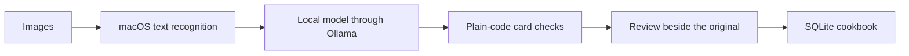

<p align="center">
  
</p>

<h1 align="center">Zendish</h1>

<p align="center"><strong>Turn recipe screenshots into a cookbook you'll actually use.</strong><br>
Drop in a screenshot or photo, check the card beside the original, and save it.<br>
Free, powered by local AI through Ollama, and everything stays on your Mac.</p>

<p align="center">
  <a href="https://github.com/zenwyn-naicker/zendish/releases/latest/download/Zendish.dmg"><strong>Download for Mac</strong></a>
</p>

## What it does

- **Add images your way:** drag them into the window or choose them from your Mac. Several images can make up one recipe.
- **Get a clean card:** Zendish reads the text and writes out the title, ingredients, steps, time and servings.
- **Check it against the original:** each card opens beside its images, so mistakes are easy to spot.
- **See what needs attention:** Zendish flags quantities that look misread and ingredients it thinks were missed.
- **No made-up details:** if a time or serving count isn't clearly labelled in the image, it stays blank.
- **Build your cookbook:** organise recipes into collections, and search by dish or ingredient.
- **Take it to the kitchen:** export a recipe or a whole collection as a PDF.
- **Light or dark:** follows your Mac by default, or choose one in Settings.

## Install Zendish

You'll need a Mac with Apple Silicon (M1 or newer), macOS 14 or later, 16 GB of memory, about 10 GB of free space, and internet for the first setup. You won't need Terminal or an account.

**1. Install Zendish**

1. [Download Zendish.dmg](https://github.com/zenwyn-naicker/zendish/releases/latest/download/Zendish.dmg) and open it.
2. Drag **Zendish** onto the **Applications** folder.

**2. Open it for the first time**

Zendish is a free project and isn't registered with Apple, so macOS blocks it the first time. You only need to do this once:

1. Open Zendish from Applications. When macOS warns you, click **Done**.
2. Open **System Settings**, then **Privacy & Security**.
3. Scroll down to the message about Zendish and click **Open Anyway**.
4. Enter your Mac password if asked, then click **Open Anyway** again.

**3. Install Ollama**

Ollama is the free app that runs the AI on your Mac, so your recipes never leave it.

1. Click **Open Ollama** in the bar at the top of Zendish. If Ollama isn't installed yet, this opens its download page.
2. Download Ollama, move it to Applications and open it. You don't need to sign in.
3. Zendish notices when Ollama is running.

**4. Download the AI model**

Click **Download** in the bar at the top of Zendish. It's a one-time download of about 7.6 GB, and you'll see its progress.

**5. Add your first recipe**

1. Drag a recipe screenshot into the window, or click **Choose Images**.
2. When the card is ready, open it from **To Review**.
3. Check it beside the original, then click **Save to Cookbook**.

## If something goes wrong

| Problem | What to do |
|---|---|
| The bar at the top says Zendish needs Ollama | Click **Open Ollama**. It needs to be running whenever Zendish reads a recipe. |
| A card says it couldn't be read | Make sure Ollama is open, then open the card and click **Try Again**. |
| A card says no recipe was found | The image may not have enough text. You can type the recipe in, or discard it. |
| The first card takes about a minute | Zendish is loading the AI model. Later cards are usually much quicker. |
| Your Mac feels slow while reading | The model uses a lot of memory. Closing large apps helps. |

## Your privacy

- The AI runs on your Mac through Ollama. Zendish has no accounts, tracking or analytics.
- Zendish only connects to Ollama on your own Mac. The internet is only used to download Ollama and its model.
- Your images and recipes stay in `~/Library/Application Support/Zendish`.
- Recipes you save are for your own use, so please respect the original authors' copyright.

# For developers

## How it works



| Part | Responsibility |
|---|---|
| `ZendishCore` | Recipes, storage, text recognition, Ollama, card checks and PDF export |
| `ZendishUI` | SwiftUI screens and the import queue |
| `Zendish` | The app itself |

The reasons behind the main decisions are in [the design notes](docs/DESIGN.md).

## Build and test

You'll need Xcode 26 or newer. Ollama is only needed to run the app, not the tests.

```bash
swift build
swift test
swift run Zendish
```

To build the app and disk image in `dist/`:

```bash
./scripts/package-macos.sh
```

The app is ad-hoc signed rather than notarised, because notarising needs a paid Apple Developer account. That's why macOS shows a warning on first launch.

## Evaluation

These results come from one Mac, a 16 GB M3 MacBook Air, using `qwen3.5:9b`.

| Test set | Result |
|---|---|
| 20 invented recipe pages | 18 cards right, and 2 wrong because of one misread quantity pattern |
| 10 real recipe websites | 7 cards correct apart from the title, 1 needing lines tidied, and 2 with a misread quantity |
| Time per card | About 14 seconds on invented pages, and about 25 seconds on real pages, with the slowest at 60 |

The sets are small and most results were checked by a script, so this is a regression check rather than a benchmark. Social media screenshots and photos of cookbooks haven't been measured yet. The 20 invented cases are included in the tests.

## License

[MIT](LICENSE)

## Built with

[Swift](https://swift.org), [SwiftUI](https://developer.apple.com/swiftui/), [Vision](https://developer.apple.com/documentation/vision), [SQLite](https://sqlite.org), [Ollama](https://ollama.com) and [Qwen](https://ollama.com/library/qwen3.5).
